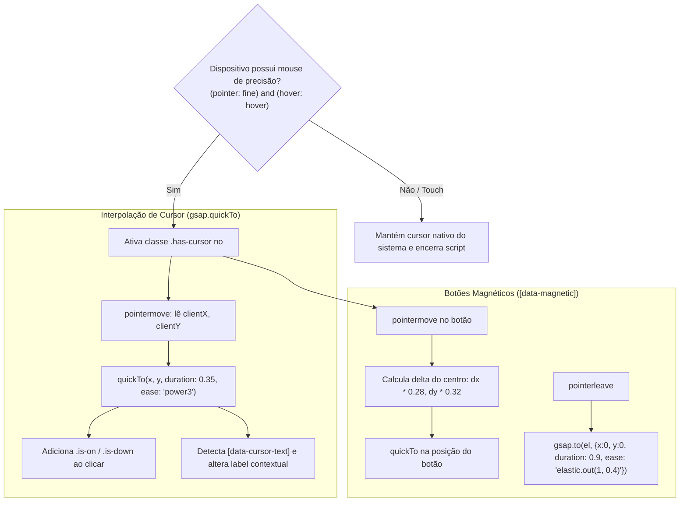

# Sistema de Animações e Interatividade: Engenharia Reversa e Padrões Modernos

> **Classificação de Informações:**
> - **[FATO OBSERVADO]**: Baseado diretamente na análise estática dos códigos fonte fornecidos (`sections_js.txt`, `scenes_js.txt`, `cursor_js.txt`, `vmap_js.txt`, `intro_js.txt`, `main_css.txt`).
> - **[INFERÊNCIA]**: Dedução técnica sobre razões de performance e escolhas de design subjacentes.
> - **[RECOMENDAÇÃO]**: Diretrizes para especificação das animações da nova experiência (Sorveteria Artesanal de Alta Gastronomia).

---

## 1. Visão Geral do Sistema de Animações

O motor de animação baseia-se em um modelo híbrido:
1. **Animações Contínuas Orientadas a Scroll (Scrub)**: O progresso da barra de rolagem controla diretamente o tempo e a posição dos elementos DOM e das cenas 3D.
2. **Animações de Disparo Único (Triggered/Once)**: Elementos textuais, revelações caligráficas e traçados vetoriais disparam uma única vez quando a seção atinge um limiar do viewport (ex.: `top 85%`).
3. **Microinterações Reativas de Ponteiro**: Efeitos jelly em tipografia, inclinação 3D de cartões, cursores com interpolação física (`quickTo`) e botões magnéticos.
4. **Respeito Estrito à Acessibilidade**: Bypass completo de interpolações temporais quando `prefers-reduced-motion` está ativo.

---

## 2. Inventário Completo de Seções e Gatilhos (ScrollTrigger)

A tabela abaixo disseca todas as animações orquestradas em `sections.js`:

| Seção / Elemento | Seletor / Alvo | Tipo de Gatilho | Intervalo de Scroll | Propriedades Animadas | Scrub / Duração | Pinned? | Comportamento Mobile |
| :--- | :--- | :--- | :--- | :--- | :--- | :--- | :--- |
| **Títulos com Máscara** | `[data-split-chars]` | ScrollTrigger | `start: 'top 85%'` | `yPercent: 115 -> 0`, `rotation: random(-14, 14) -> 0` | Duração 1.1s, stagger 0.025s, `back.out(1.4)` | Não | Idêntico ao desktop |
| **Linhas de Texto** | `[data-split-lines]` | ScrollTrigger | Auto (`top 85%`) | `yPercent: 105 -> 0` | Duração 1.1s, stagger 0.1s, `expo.out` | Não | Idêntico ao desktop |
| **Pincelada SVG** | `[data-draw-reveal]` | ScrollTrigger | `start: 'top 80%'` | `strokeDashoffset: len -> 0` | Duração 1.9s, `power1.inOut` | Não | Idêntico ao desktop |
| **Parallax Geral** | `[data-parallax]` | ScrollTrigger | `top bottom` a `bottom top` | `yPercent: -amt -> amt` | `scrub: true` contínuo | Não | Suportado |
| **Texto Caligráfico** | `[data-sign]` | ScrollTrigger | `start: 'top 85%'` | Wrapper: `xPercent: -100 -> 0`, Interno: `xPercent: 100 -> 0` | Duração 1.6s, `power2.inOut` | Não | Compositing em GPU (sem `clip-path`) |
| **01. Hero** | `.s-hero` | ScrollTrigger | `top top` a `bottom top` | - Escreve `state.hero.p`<br>- `.s-hero__title`: `yPercent: 30`, `scale: 0.86`<br>- `.s-hero__motif`: `rotate: 6`, `scale: 1.2`<br>- Metadados: `opacity: 0`, `y: -40` (0% a 45%) | `scrub: true` contínuo | Não | Adapta aspect ratio da câmera 3D e reposiciona logo |
| **Logo da Topbar** | `.topbar__logo` | ScrollTrigger | Scroll contínuo | `rotation: clamp(-20, 20, velocity / 120)` | `quickTo` duração 0.6s, `power3` | Não | Reduz tamanho de 84px para 76px |
| **Marquee Infinito** | `[data-marquee]` | Ticker + ST | Scroll contínuo | Aceleração do loop infinito: `boost = 1 + velocity / 300` | Loop contínuo com desaceleração exponencial (`boost += (1-boost)*0.05`) | Não | Reduz tamanho da fonte tipográfica |
| **03. Definição** | `[data-words]` | ScrollTrigger | `start: 'top 78%'`, `end: 'bottom 50%'` | Palavras individuais (`split-word`): `opacity: 0.12 -> 1` | `scrub: true`, stagger 0.08s | Não | Idêntico ao desktop |
| **Carimbo da Seção** | `[data-stamp]` | ScrollTrigger | `top bottom` a `center center` | `scale: 0.82 -> 1`, `rotate: -4 -> 0` | `scrub: true` | Não | Idêntico ao desktop |
| **04. Build (Montagem)** | `[data-build-pin]` | ScrollTrigger | `top top` até `+=4 * innerHeight` | - Escreve `state.build.p`<br>- Barra de progresso: `scaleX(p)`<br>- Passos (`li`): toggles `.is-active` e `.is-done`<br>- Textos de resultado (`autoAlpha`, `y`) | `scrub: true`, `anticipatePin: 1` | **Sim (4 viewports)** | Título introdutório se esconde antecipadamente (`p > 0.015`) para evitar sobreposição |
| **05. Galeria Horizontal** | `[data-gallery-pin]` | ScrollTrigger | `top top` até `+=dist()` | - Translação do trilho: `x: -dist`<br>- Card 3D rotativo: `rotate: 6 -> 0`, `scale: 0.86 -> 1`<br>- Imagem interna: `xPercent: -6 -> 6` (paralaxe interno)<br>- Título: revelação `back.out(2)` | `scrub: true`, `anticipatePin: 1` | **Sim (comprimento do trilho)** | Largura do card adaptada para `66vw` |
| **07. Amigos (Duo)** | `[data-duo]` | ScrollTrigger | `center center` até `+=1.2 * innerHeight` | Volet de revelação:<br>- Camada externa: `xPercent: 0 -> 100`<br>- Conteúdo interno: `xPercent: 0 -> -100`<br>- Linha divisora: `x: 0 -> frameWidth` | `scrub: true`, `anticipatePin: 1` | **Sim (1.2 viewports)** | Altura do frame reduzida |
| **08. Horários / Drinks** | `.s-hours` | ScrollTrigger | `start: 'top 85%'`, `end: 'center center'` | - Escreve `state.drinks.p`<br>- Linhas de horário: `xPercent: -30 -> 0`, `opacity: 0 -> 1`<br>- Disco decorativo: `scale: 0.5 -> 1`, `rotate: -30 -> 0` | `scrub: true` e `once: true` | Não | Idêntico ao desktop |
| **09. Nós Encontrar** | `.s-visit` | ScrollTrigger | `top bottom` a `bottom top` | - Ações/pictos: `y: 30 -> 0`, `opacity: 0 -> 1`<br>- Ilustração: `rotate: -25 -> 8`, `scale: 0.6 -> 1`<br>- Marquee de fundo: `xPercent: 0 -> -33.333%` | `scrub: true` | Não | Desativa inclinação 3D se `pointer: coarse` |
| **10. Final (¡Vamos!)** | `.s-end` | ScrollTrigger | `start: 'top 60%'`, `end: 'bottom top'` | - Split chars: `yPercent: 120 -> 0`, `rotate: random(-30, 30) -> 0`, `elastic.out`<br>- Ativa `state.rain.active = s.isActive`<br>- Limpeza ao subir: `onLeaveBack: state.rain.reset()` | `toggleActions` no texto, scrub no toggle 3D | Não | Reduz contagem de corpos na chuva de 18 para 7 |

---

## 3. Dissecção Técnica de Técnicas Avançadas de Animação

### 3.1. Efeito Jelly Hover em Tipografia (`[data-jelly]`) [FATO OBSERVADO]
- Aplicado em títulos de alto impacto. Ao passar o mouse sobre um caractere individual (`.split-char`):
  ```javascript
  gsap.fromTo(ch, 
    { y: 0, scaleY: 1 }, 
    { 
      y: '-0.22em', 
      scaleY: 1.12, 
      duration: 0.22, 
      yoyo: true, 
      repeat: 1, 
      ease: 'power2.out', 
      transformOrigin: '50% 100%', 
      color: '#FEB914', 
      clearProps: 'color' 
    }
  );
  ```
- *Otimização*: Utiliza `gsap.isTweening(ch)` para ignorar novos disparos enquanto a oscilação estiver ativa, prevenindo stuttering. O `transformOrigin: '50% 100%'` (base do caractere) produz uma deformação elástica natural de "gelatina saltitante".

### 3.2. Pincelada Caligráfica via GPU (`[data-sign]`) [FATO OBSERVADO & INFERÊNCIA]
- Evita `clip-path: polygon(...)`, que força o navegador a recalcular a rasterização de polígonos complexos a cada frame.
- A técnica observada substitui o elemento por dois spans aninhados (`.wipe` e `.wipe__in`):
  - `.wipe`: `transform: translateX(-100% -> 0)` com `overflow: hidden`.
  - `.wipe__in`: `transform: translateX(100% -> 0)`.
- *Resultado*: A combinação de vetores opostos cria um volet perfeito executado inteiramente na camada de composição da GPU (`Composite Layers`), sem acionar *Layout* ou *Paint*.

---

## 4. Curvas de Interpolação, Licenciamento e Alternativas Open-Source

### 4.1. Licenciamento do Ecossistema GreenSock [FATO OBSERVADO & INFERÊNCIA]
- **GSAP Core + ScrollTrigger**: Licença GreenSock Standard. **Gratuito para uso comercial padrão** (incluindo sites de marcas, restaurantes e e-commerce).
- **@gsap/react**: **Gratuito e open-source (MIT)**. Disponibiliza o hook `useGSAP` que automatiza o escopo e o cleanup de animações em React.
- **Plugins do Club GreenSock (`SplitText`, `CustomEase`)**: **Pagos**. Exigem assinatura comercial ativa.

### 4.2. Estratégia de Substituição Open-Source [RECOMENDAÇÃO]
Para garantir autonomia total e viabilidade técnica sem custos de licenciamento:
1. **Substituto do `SplitText`**: `split-type` (MIT, ~4KB gzipped).
   - Realiza a mesma segmentação do DOM em caracteres (`.char`), palavras (`.word`) e linhas (`.line`).
2. **Substituto do `CustomEase`**: `bezier-easing` (MIT, ~1KB) ou funções cúbicas nativas do CSS/GSAP.
   - Permite instanciar curvas cúbicas como `const easeTopas = bezierEasing(0.2, 0.8, 0.2, 1);` e consumi-las dentro de loops ou tweens.

### 4.3. Easings Analíticos no Loop 3D [FATO OBSERVADO]
Dentro de `scenes.js`, o código aplica funções matemáticas puras sobre o progresso $P$:
- `easeOutBounce(x)`: Equação quadrática por partes para quedas e impactos físicos.
- `easeOutBack(t, s = 1.7)`: Ultrapassagem elástica com retorno amortecido.
- `range(v, a, b)`: Mapeador fundamental para scrub bidirecional sem timelines adicionais.

---

## 5. Integração Segura com React (`useGSAP`)

A criação de timelines em Client Components do Next.js deve seguir o padrão oficial para evitar vazamento de memória e conflitos com o Strict Mode do React:

```tsx
'use client';

import { useRef } from 'react';
import gsap from 'gsap';
import { ScrollTrigger } from 'gsap/ScrollTrigger';
import { useGSAP } from '@gsap/react';

if (typeof window !== 'undefined') {
  gsap.registerPlugin(ScrollTrigger);
}

export function PinnedShowcase({ onUpdate }: { onUpdate: (progress: number) => void }) {
  const containerRef = useRef<HTMLDivElement>(null);

  useGSAP(
    () => {
      ScrollTrigger.create({
        trigger: containerRef.current,
        start: 'top top',
        end: '+=150%',
        pin: true,
        scrub: true,
        onUpdate: (self) => onUpdate(self.progress),
      });
    },
    { scope: containerRef } // Garante que tudo criado aqui seja revertido no unmount
  );

  return <section ref={containerRef} className="pin-container" />;
}
```

---

## 6. Sistema de Cursor Customizado e Magnetismo (`cursor.js`)



- **`gsap.quickTo`**: Cria uma função de tweening reutilizável e pré-alocada, evitando instanciar novos objetos `gsap.to()` a cada evento de `pointermove` (zero pressão sobre o Garbage Collector).

---

## 7. Critérios Verificáveis de Performance de Animações

1. **Tempo de Frame**: Tempo de frame gasto em animações DOM/GSAP $< 16.6\text{ ms}$ (mantendo 60 fps sustentados).
2. **Cumulative Layout Shift (CLS)**: $\text{CLS} = 0$. Os particionamentos de texto (`split-type`) devem ser executados com dimensões de linha preservadas sem deslocamento visível de layout.
3. **Scrub Reversível sem Jitter**: Rolar rapidamente para frente e para trás não pode acumular estados, disparar mutações em loop ou dessincronizar o elemento 3D do pin DOM.
