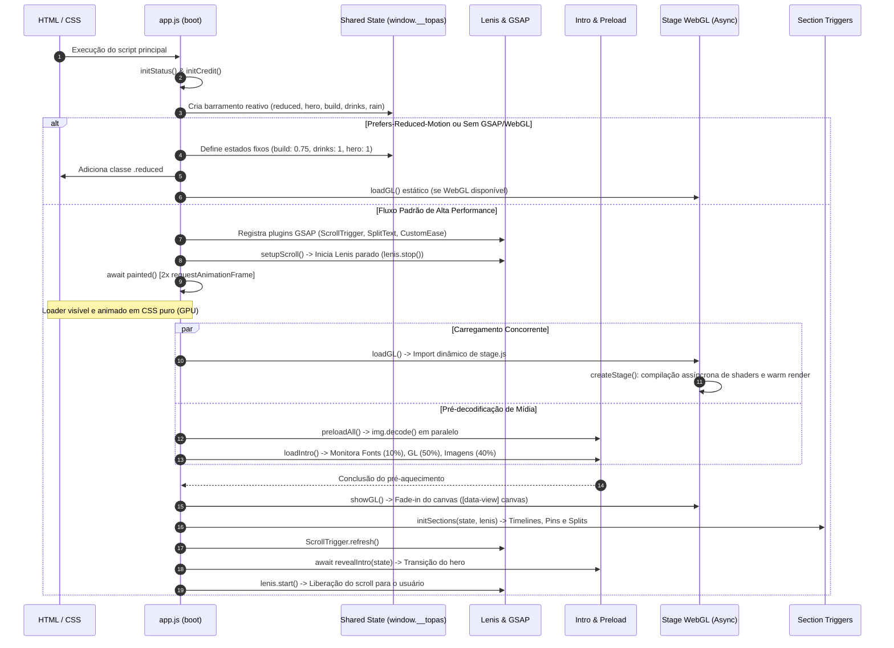
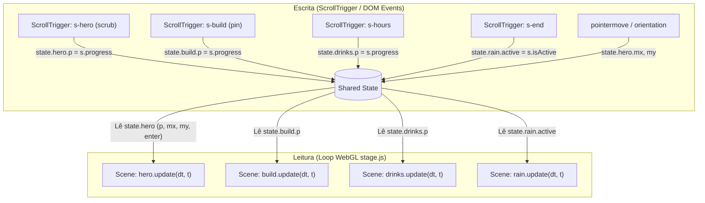

# Análise Arquitetural: Engenharia Reversa do Pipeline Interativo

> **Classificação de Informações:**
> - **[FATO OBSERVADO]**: Baseado diretamente na análise estática dos 16 arquivos técnicos fornecidos (`app_ja.txt`, `scroll_js.txt`, `stage_js.txt`, `scenes_js.txt`, `sections_js.txt`, `dishes_js.txt`, `food_js.txt`, `intro_js.txt`, `preload_js.txt`, `textures_js.txt`, `noice_js.txt`, `cursor_js.txt`, `status_js.txt`, `vmap_js.txt`, `credit_js.txt`, `main_css.txt`).
> - **[INFERÊNCIA]**: Dedução técnica sobre o ambiente de build, empacotamento ou dependências ausentes no repositório.
> - **[RECOMENDAÇÃO]**: Diretrizes de engenharia para adaptação em Next.js com TypeScript voltada ao novo produto.

---

## 1. Visão Geral da Arquitetura

O sistema analisado representa uma **SPA (Single-Page Application) altamente coreografada**, baseada em um pipeline híbrido **DOM + Canvas 2D + WebGL Offscreen**. 

Em vez de renderizar o site inteiro dentro de uma cena 3D ou instanciar múltiplos renderizadores WebGL no DOM, a arquitetura utiliza:
1. **Um único contexto WebGL desacoplado do DOM (`stage.js`)**, responsável por calcular e rasterizar todas as cenas.
2. **Canvases 2D leves por seção HTML**, que recebem os frames da cena WebGL via transferência por blit (`drawImage`), permitindo que elementos 3D respeitem o fluxo natural de documento, z-index, máscaras CSS e seções fixadas (`pin`).
3. **Um barramento de estado mutável em memória (`window.__topas`)**, atualizado por gatilhos de scroll (`ScrollTrigger`) e ponteiro a 60 fps, sem disparar renderizações de frameworks reativos.
4. **Um motor de animação e scroll unificado**, onde o GSAP Ticker atua como o relógio central mestre, sincronizando o smooth scroll (`Lenis`) e o loop de renderização Three.js.

---

## 2. Diferenciação Crucial: Canvas Fora do DOM vs. OffscreenCanvas vs. Web Workers

Para garantir precisão arquitetural e evitar equívocos comuns de nomenclatura, é fundamental diferenciar três conceitos:

```mermaid
flowchart TD
    subgraph C1["1. Canvas Desacoplado do DOM (DOM-Detached)"]
        D1["document.createElement('canvas')<br>(Não inserido no body)"]
        D2["Roda 100% na MAIN THREAD"]
        D3["Usado na referência (stage.js)"]
        D1 --> D2 --> D3
    end

    subgraph C2["2. OffscreenCanvas API (W3C)"]
        O1["new OffscreenCanvas(w, h)<br>ou transferControlToOffscreen()"]
        O2["Pode rodar na Main Thread ou em Worker"]
        O3["Não é elemento DOM (sem style/eventos)"]
        O1 --> O2 --> O3
    end

    subgraph C3["3. WebGL em Web Workers"]
        W1["Thread separada em background"]
        W2["Isola render do JavaScript da página"]
        W3["Problema: latência de postMessage com Scroll/DOM"]
        W1 --> W2 --> W3
    end
```



1. **Canvas Fora do DOM (*DOM-Detached HTMLCanvasElement*) [FATO OBSERVADO]**:
   - É exatamente o padrão implementado no código de referência (`stage_js.txt`).
   - O Three.js instancia um elemento `<canvas>` que nunca é anexado à árvore visual (`document.body.appendChild`). Ele executa **integralmente na Main Thread**.
   - *Vantagem*: Sincronização determinística e síncrona com os eventos de scroll do Lenis e do ScrollTrigger no mesmo tick do relógio do navegador.
2. **`OffscreenCanvas` API Nativa (HTML5) [INFERÊNCIA TÉCNICA]**:
   - Especificação do W3C para desacoplar a superfície de desenho da janela do navegador. Não possui atributos de estilo CSS nem escuta eventos de ponteiro diretamente.
3. **WebGL em Web Workers [INFERÊNCIA TÉCNICA]**:
   - Mover a execução do Three.js para um Worker dedicado via `postMessage`.
   - *Trade-off*: Embora isole a GPU da thread de UI, a mensageria assíncrona causa **latência de sincronização (jitter)** em seções pinadas e scrubs milimétricos com o scroll da Main Thread. Por isso, a abordagem em Main Thread sincronizada ao GSAP Ticker foi a escolhida na referência e continua sendo a mais recomendada para sites scroll-driven de precisão.

---

## 3. Fluxo Completo de Inicialização (`app.js` / `boot()`)

O ciclo de inicialização foi projetado em torno de um princípio fundamental: **nenhuma operação pesada (compilação de shaders, decodificação de imagens, criação de malhas complexas) pode ocorrer antes que a interface exiba o estado inicial de carregamento ao usuário.**



### Detalhamento das Etapas de Boot

1. **Leitura de Configuração e Acessibilidade [FATO OBSERVADO]:**
   - O script lê dados estáticos serializados no DOM em `#emg-topas-data` (evita requisições de rede adicionais).
   - Avalia a media query `(prefers-reduced-motion: reduce)`.
   - Testa a disponibilidade de WebGL 2 via canvas descartável (`window.WebGL2RenderingContext && c.getContext('webgl2')`).

2. **Criação do Barramento de Estado [FATO OBSERVADO]:**
   - Instancia o objeto `window.__topas`:
     ```javascript
     state = {
       reduced,
       hero: { p: 0, mx: 0, my: 0, enter: 0 },
       build: { p: 0 },
       drinks: { p: 0 },
       rain: { active: false, reset: null }
     }
     ```

3. **Bifurcação de Modo Reduzido / Degradação [FATO OBSERVADO]:**
   - Caso `reduced` seja verdadeiro ou bibliotecas críticas estejam ausentes:
     - Adiciona a classe `.reduced` ao elemento raiz `<html>`.
     - Atribui valores estáticos ao estado (`build.p = 0.75`, `drinks.p = 1`, `hero.enter = 1`).
     - Renderiza o mapa e as cenas 3D de forma estática, sem binds com scroll.

4. **Registro de Plugins e Configuração do ScrollTrigger [FATO OBSERVADO]:**
   - Registra `ScrollTrigger`, `SplitText` e `CustomEase`.
   - Configura `ScrollTrigger.config({ ignoreMobileResize: true, autoRefreshEvents: 'visibilitychange,DOMContentLoaded,load' })`.
     - *Justificativa técnica*: evita que o aparecimento ou recolhimento da barra de endereços em navegadores mobile (iOS Safari / Chrome Android) cause saltos bruscos nos pins (`resize` vertical falso).
   - Cria curva cúbica proprietária `CustomEase.create('topas', 'M0,0 C0.2,0.8 0.2,1 1,1')`.

5. **Trava Inicial de Rolagem e Pintura do Loader (`painted()`) [FATO OBSERVADO]:**
   - `lenis.stop()` bloqueia interações de scroll durante o carregamento.
   - Executa `await painted()`: duas chamadas aninhadas de `requestAnimationFrame`.
     - *Justificativa técnica*: garante que a thread de composição do browser termine o layout e pinte o primeiro frame do loader HTML/CSS antes de disparar o JavaScript intensivo.

6. **Carregamento e Pré-aquecimento Paralelo [FATO OBSERVADO]:**
   - Dispara dinamicamente `import('emg-topas/gl/stage')` encapsulado em uma rotina com retry automático (espera de 1200ms em caso de falha de rede transitória).
   - Executa `preloadAll()`, que itera sobre todas as imagens da página (exceto as de fallback), forçando o carregamento eager e disparando `img.decode()` na CPU/GPU.
   - O componente `intro.js` pondera o progresso: 10% Fontes (`document.fonts.ready`), 50% WebGL (`loadGL`), 40% Decodificação de Imagens.

7. **Montagem de Gatilhos DOM e Abertura [FATO OBSERVADO]:**
   - Com o estágio 3D pré-aquecido e imagens decodificadas, chama `initSections(state, lenis)` para particionar textos (`SplitText`) e montar os triggers pinados.
   - Chama `ScrollTrigger.refresh()` para calcular as coordenadas geométricas dos pins antes da revelação.
   - Executa `revealIntro(state)`, timeline que abre as cortinas superiores do loader e aciona a transição `state.hero.enter: 1`.
   - Chama `lenis.start()`, liberando a navegação.

8. **Tratamento Resiliente de Redimensionamento [FATO OBSERVADO]:**
   - Um listener de `resize` na janela compara `innerWidth === lastW`. Se apenas a altura mudar (como na barra de navegação mobile), o evento é descartado. Se a largura mudar, aplica debounce de 250ms antes de chamar `ScrollTrigger.refresh()`.

---

## 4. Integração entre Lenis, GSAP e ScrollTrigger

A integração entre `Lenis` e `GSAP` é implementada em `scroll_js.txt`. Ela resolve o conflito clássico entre dois motores que tentam controlar o cálculo de scroll da página.

```mermaid
flowchart LR
    subgraph RAF_Loop["Loop Central (GSAP Ticker)"]
        Tick[GSAP Ticker]
    end

    subgraph Smooth_Engine["Motor de Suavização"]
        Tick -->|time * 1000| LenisRAF["lenis.raf(ms)"]
        LenisRAF -->|Calcula interpolação lerp: 0.09| ScrollVirtual["Scroll Virtual / Posição Suavizada"]
    end

    subgraph Trigger_Sync["Sincronização de Triggers"]
        ScrollVirtual -->|lenis.on('scroll')| STUpdate["ScrollTrigger.update()"]
        STUpdate -->|Atualiza progresso 0..1| StateBridge["state.[seção].p"]
    end
```

### Detalhes de Implementação [FATO OBSERVADO]

```javascript
// Configuração do Lenis
const lenis = new Lenis({
  lerp: 0.09,              // Coeficiente de inércia suave
  wheelMultiplier: 0.95,   // Amortecimento do scroll wheel
  touchMultiplier: 1.4     // Sensibilidade touch acelerada
});

// 1. Sincronização direta de eventos
lenis.on('scroll', ScrollTrigger.update);

// 2. Acoplamento no relógio unificado do GSAP
gsap.ticker.add((time) => lenis.raf(time * 1000));

// 3. Desativação de suavização de lag no ticker
gsap.ticker.lagSmoothing(0);
```

### Trade-offs e Decisões Técnicas [FATO OBSERVADO & INFERÊNCIA]
1. **`gsap.ticker.lagSmoothing(0)`**:
   - O mecanismo de `lagSmoothing` padrão do GSAP retarda ou "engole" deltas de tempo quando uma queda de framerate é detectada. Porém, com Lenis acoplado ao ticker, o `lagSmoothing` provocava dessincronização entre a posição física do scroll e o cálculo do ScrollTrigger, gerando sensação de "borracha" ou atraso acumulado. A desativação garante sincronismo determinístico frame a frame.
2. **Scroll em Âncoras Locais**:
   - `scroll_js.txt` intercepta cliques em `a[href^="#"]` e delega a animação para `lenis.scrollTo(target, { duration: 1.6 })`, garantindo desaceleração contínua sem quebrar o rastreamento dos gatilhos de seção.

---

## 5. O Padrão State Bridge (Scroll -> 3D)

O gargalo mais comum em aplicações interativas ricas reside na atualização do estado: disparar renderizações de frameworks (React, Vue) a cada evento de scroll bloqueia a Main Thread.

A arquitetura resolve essa questão desacoplando **escrita de scroll** e **leitura de renderização** por meio de um objeto compartilhado mantido em escopo de memória global (`window.__topas`):



---

## 6. Disponibilidade e Licenciamento dos Plugins GSAP

Para planejar a arquitetura sem riscos legais ou custos ocultos, analisamos o licenciamento atual do ecossistema GreenSock:

| Módulo / Plugin | Licença | Custo / Disponibilidade | Estratégia Adotada |
| :--- | :--- | :--- | :--- |
| **GSAP Core** | GreenSock Standard | **Gratuito** para uso comercial padrão (sites, campanhas, e-commerces onde o acesso ao site não é cobrado). | Manter oficial (`gsap`) |
| **ScrollTrigger** | GreenSock Standard | **Gratuito** incluso no pacote padrão (`gsap/ScrollTrigger`). | Manter oficial (`gsap/ScrollTrigger`) |
| **@gsap/react** | MIT | **Gratuito e open-source**. Pacote oficial que disponibiliza o hook `useGSAP`. | Utilizar (`@gsap/react`) |
| **SplitText** | Club GreenSock | **Pago** (requer assinatura ShockinglyGreen ou BusinessGreen e token privado `.npmrc`). | **Substituir por `split-type` (MIT, gratuito)** |
| **CustomEase** | Club GreenSock | **Pago** (requer assinatura Club GreenSock). | **Substituir por `bezier-easing` (MIT, gratuito)** |
| **MorphSVG** | Club GreenSock | **Pago** (requer assinatura Club GreenSock). | **Não utilizar no DOM**. No 3D, utilizar Three.js nativo (`morphTargetInfluences`), 100% gratuito. |

---

## 7. Integração GSAP com React / Next.js com Criação e Limpeza Seguras

O ciclo de vida do React (especialmente com React 18/19 e Strict Mode em desenvolvimento, que monta, desmonta e remonta componentes) exige que toda timeline ou ScrollTrigger seja descartada adequadamente para evitar acúmulo de listeners ou instâncias fantasmas.

### Abordagem Moderna Recomendada: Hook Oficial `@gsap/react` (`useGSAP`)

```tsx
'use client';

import { useRef } from 'react';
import gsap from 'gsap';
import { ScrollTrigger } from 'gsap/ScrollTrigger';
import { useGSAP } from '@gsap/react';

// Registro seguro fora do ciclo de renderização
if (typeof window !== 'undefined') {
  gsap.registerPlugin(ScrollTrigger);
}

export function PinnedSection({ onProgress }: { onProgress: (p: number) => void }) {
  const containerRef = useRef<HTMLDivElement>(null);
  const titleRef = useRef<HTMLHeadingElement>(null);

  // useGSAP encapsula automaticamente um gsap.context() vinculado ao scopeRef
  useGSAP(
    () => {
      // Criação de ScrollTrigger com pin
      ScrollTrigger.create({
        trigger: containerRef.current,
        start: 'top top',
        end: '+=200%',
        pin: true,
        scrub: true,
        anticipatePin: 1,
        onUpdate: (self) => {
          onProgress(self.progress);
        },
      });

      // Animação de texto sincronizada
      gsap.to(titleRef.current, {
        yPercent: -20,
        opacity: 0.8,
        ease: 'none',
        scrollTrigger: {
          trigger: containerRef.current,
          start: 'top top',
          end: '+=100%',
          scrub: true,
        },
      });
    },
    { scope: containerRef } // Limpeza determinística: reverte todas as animações no unmount
  );

  return (
    <section ref={containerRef} className="pinned-section">
      <h2 ref={titleRef}>Gelato Artesanal</h2>
    </section>
  );
}
```

---

## 8. Dependências Atualizadas e Estáveis

| Dependência | Versão Recomendada | Justificativa de Compatibilidade |
| :--- | :--- | :--- |
| **next** | `^14.2.18` (ou `^15.0.3`) | Versão estável do App Router com suporte consolidado a Server/Client Components. |
| **react / react-dom** | `^18.3.1` (ou `^19.0.0`) | Compatibilidade plena com Three.js e ecossistema de hooks. |
| **three** | `^0.170.0` | Versão moderna com ColorSpace SRGB nativo, WebGL 2 por padrão e descarte seguro de recursos. |
| **@types/three** | `^0.170.0` | Tipagem TypeScript estrita e alinhada ao Three.js. |
| **gsap** | `^3.12.5` | Versão estável com todas as correções de compatibilidade para navegadores modernos. |
| **@gsap/react** | `^2.1.1` | Pacote oficial para integração GSAP + React. |
| **lenis** | `^1.1.14` | Versão oficial e moderna do Lenis (substitui o antigo `@studio-freight/lenis`). |
| **split-type** | `^0.3.4` | Alternativa MIT para particionamento de caracteres e linhas de texto sem custos. |

---

## 9. Critérios Verificáveis de Desempenho, Acessibilidade e Limpeza

1. **Desempenho**:
   - $\ge 55$ FPS contínuos em scroll contínuo em aparelho mobile intermediário (ex.: Moto G, iPhone 11/12).
   - Draw calls $\le 5$ por frame na Prova de Conceito.
   - Lighthouse Performance $\ge 90$ no Desktop e $\ge 80$ no Mobile.
2. **Acessibilidade (WCAG 2.1 AA)**:
   - Respeito a `prefers-reduced-motion: reduce`: scroll nativo desativando Lenis, objeto 3D estático sem rotação contínua e sem timelines ativas de scrub.
   - Contraste de cores mínimo $4.5:1$ e foco visível (`:focus-visible`).
3. **Responsividade**:
   - Layout fluido de 320px a 2560px sem transbordamento horizontal (`overflow-x: clip`).
   - `ScrollTrigger.config({ ignoreMobileResize: true })` para suprimir saltos da barra de navegação no Safari iOS e Chrome Android.
4. **Descarte de Recursos (Cleanup)**:
   - Ao desmontar a rota/componente: 0 instâncias ativas no `ScrollTrigger.getAll()`, `lenis.destroy()` executado, `renderer.dispose()` e `renderer.forceContextLoss()` concluídos, com 0 vazamento de contextos WebGL após 20 remontagens consecutivas.
