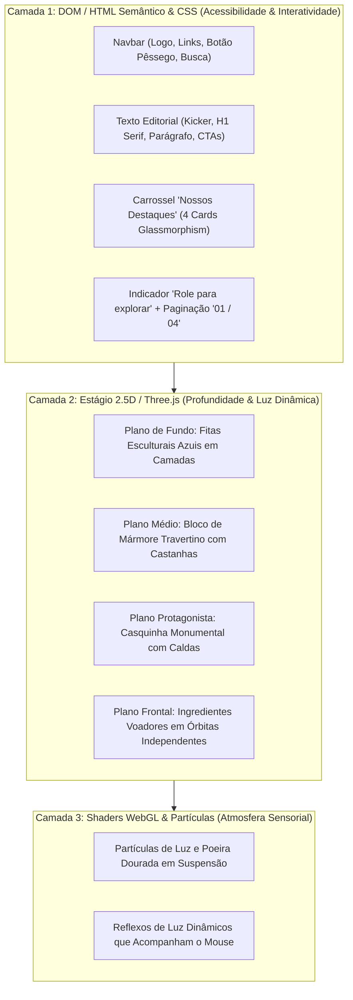
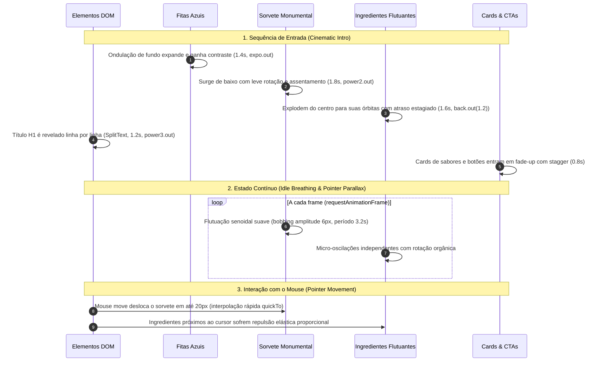
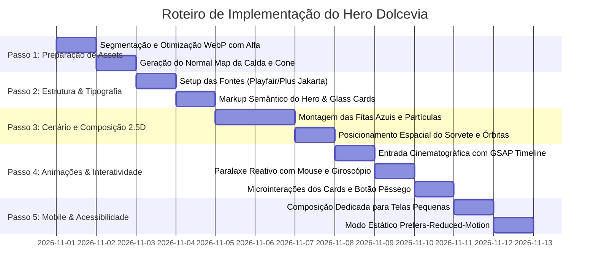

# Direção Visual & Arquitetura de Interação: Dolcevia Gelato Artesanal

> **Documento de Direção de Arte e Engenharia Front-end**  
> **Referência Obrigatória**: `Experiência Sensorial Dolcevia.png`  
> **Finalidade**: Decompor a composição visual aprovada e estruturar a arquitetura técnica para transformá-la em uma experiência web cinematográfica, interativa e de alta performance.

---

## 1. Análise Visual e Decomposição da Composição Aprovada

A imagem aprovada **`Experiência Sensorial Dolcevia.png`** estabelece um novo padrão estético para o projeto: sai a paleta monocromática terrosa e entra uma atmosfera de **alta gastronomia sensorial, contraste dramático e tridimensionalidade cinematográfica**.

```
┌────────────────────────────────────────────────────────────────────────────────────────┐
│ NAVBAR: Logo linear "Dolcevia" | Menu clean | Botão Pêssego "Fale conosco" | Busca     │
├──────────────────────────────────────────┬─────────────────────────────────────────────┤
│ COLUNA EDITORIAL (40% largura)          │ COLUNA HERO / PRODUTO (60% largura)         │
│                                          │                                             │
│ • Kicker: "MAIS QUE SORVETE,"            │ • Nuvens/fitas azuis acetinadas em camadas  │
│ • H1: "Uma experiência sensorial"       │ • SORVETE MONUMENTAL (Pistache, Frutas,     │
│   (Serif editorial monumental)           │   Chocolate Belga, Calda Caramelo, Cone)    │
│ • Subtítulo poético                      │ • Explosão de ingredientes suspensos no ar: │
│ • Botões: Pêssego Primário + Vídeo Glass │   Morango fatiado, framboesas, mirtilos,    │
│ • Carrossel "Nossos Destaques":          │   avelãs, castanhas, lascas de chocolate    │
│   4 cards translúcidos de sabores        │ • Base de mármore com elementos repousados  │
├──────────────────────────────────────────┴─────────────────────────────────────────────┤
│ FOOTER/INDICADOR: "ROLE PARA EXPLORAR" com ícone de mouse | Paginação lateral "01 / 04"│
└────────────────────────────────────────────────────────────────────────────────────────┘
```

### 1.1. Paleta Cromática e Atmosfera de Luz

| Token | Código Hex / HSL | Aplicação na Composição |
| :--- | :--- | :--- |
| **Deep Midnight Navy** | `#051321` a `#0A2540` | Fundo principal e vinheta de profundidade da cena. |
| **Ocean Teal / Cerulean** | `#0C4263` a `#247BA0` | Ondulações e fitas esculturais do plano intermediário. |
| **Cyan Ribbon Highlight** | `#42A7CE` a `#68C2E8` | Bordas iluminadas e reflexos especulares das fitas orgânicas. |
| **Warm Peach / Apricot** | `#FCD7B0` a `#F5AC72` | Botão de conversão primário ("Fale conosco", "Descubra nossos sabores"). Transmite calor e apetite em contraste com o azul frio. |
| **Editorial Ivory White** | `#FAF9F6` | Título principal H1, textos de alto contraste e logotipo. |
| **Pale Sky Blue** | `#BFD8E8` | Subtítulo editorial e textos de apoio com leitura descansada. |
| **Ruby Berry Red** | `#E61938` / `#C81D39` | Cereja de topo, morangos frescos e framboesas maduras. |
| **Belgian Dark Chocolate** | `#2B150C` a `#4A2617` | Sorvete de chocolate, ganache escorrendo e lascas sólidas. |
| **Golden Caramel Drip** | `#DE8E35` a `#F2AF58` | Fios de calda viscosa translúcida que derretem sobre a casquinha. |
| **Travertine Stone** | `#E8E2D8` a `#CFC6B8` | Bloco de pedra mármore na base com avelãs e raspas de cacau. |

### 1.2. Tipografia Editorial e Hierarquia Visual
- **Título Display H1 ("Uma experiência sensorial")**:
  - *Estilo*: Serifada contemporânea de altíssimo contraste, proporções clássicas, curvas elegantes nas hastes e terminais orgânicos.
  - *Família recomendada*: **Cormorant Garamond**, **Playfair Display** ou **Instrument Serif**.
  - *Escala*: `clamp(2.8rem, 5.2vw, 5.6rem)` com line-height compacto (`1.05`).
- **Subtítulos, Menus e Botões**:
  - *Estilo*: Sans-serif geométrica minimalista, neutra e com alta legibilidade em qualquer densidade de pixels.
  - *Família recomendada*: **Plus Jakarta Sans** ou **Outfit**.
  - *Kickers e Indicadores*: Caixa alta (`text-transform: uppercase`), peso 600, tracking expandido (`letter-spacing: 0.12em`).

---

## 2. Mapa de Componentes: Divisão Estrutural por Tecnologia

Para preservar a riqueza visual estonteante da imagem sem comprometer a performance e a acessibilidade, dividimos a tela em camadas tecnológicas especializadas:



| Elemento Visual | Tecnologia Primária | Justificativa Técnica |
| :--- | :--- | :--- |
| **Logotipo e Navegação** | SVG + HTML / CSS | Texto pesquisável, indexável por SEO, responsivo com transição de cor no hover. |
| **Título H1 e Textos** | HTML Semântico + CSS | Acessibilidade pura para leitores de tela; animação letra/linha via GSAP. |
| **Botões Pêssego / Glass** | HTML `<button>` + CSS | Feedback tátil, foco acessível (`:focus-visible`), sombra suave e hover com GPU transform. |
| **Cards de Sabores** | HTML / CSS (Glassmorphism) | `backdrop-filter: blur(16px)`, bordas semi-transparentes e miniaturas de gelato em alta resolução. |
| **Fitas Azuis de Fundo** | Composição em Camadas SVG/WebP + Three.js Mesh | Camadas curvas independentes com movimento de paralaxe sutil oposto ao mouse. |
| **Sorvete Monumental** | Asset Mestre em Ultra-Alta Resolução + Shaders Three.js | Mantém 100% da textura fotorrealista (cristais, brilho do caramelo, poros do cone) com iluminação dinâmica. |
| **Ingredientes Flutuantes** | Planos Transparentes 2.5D no Three.js / GSAP QuickTo | Morangos, avelãs, mirtilos e gotas de calda em coordenadas Z individuais com física de flutuação e repulsão ao mouse. |
| **Partículas Atmosféricas** | Three.js Points / BufferGeometry | Micro-estrelas e poeira iluminada que conferem sensação mágica e cinematográfica. |

---

## 3. Plano de Animações e Coreografia de Interações

A experiência deve parecer um filme interativo de alta gastronomia, com movimentos fluidos, sem sobressaltos e rigorosamente calibrados.



### 3.1. Entrada Cinematográfica do Hero
- **Duração total**: 2.2 segundos orquestrados via `gsap.timeline()`.
- **Hierarquia de Revelação**:
  1. $t=0.0s$: As fitas volumétricas de fundo emergem do azul escuro para o cerúleo luminoso.
  2. $t=0.3s$: O sorvete monumental sobe suavemente a partir da base (`y: 80 -> 0`, `scale: 0.94 -> 1`), repousando sobre a bancada de mármore com inércia física.
  3. $t=0.6s$: Os ingredientes em órbita (morango fatiado, avelãs, framboesas, gotas de caramelo) disparam do centro para suas posições de descanso orbital com `stagger: 0.04s` e curva elástica suave.
  4. $t=0.8s$: O texto H1 ("Uma experiência sensorial") é desvelado por máscaras de linha (`split-line` / `overflow: clip`).
  5. $t=1.1s$: Os 4 cartões de sabores na base e o botão pêssego entram em cascata com opacidade e leve translação vertical.

### 3.2. Interações de Ponteiro (Mouse Parallax 2.5D)
- O mouse não move a tela inteira em bloco, mas opera com **paralaxe diferencial baseado em profundidade**:
  - *Fundo (Fitas azuis)*: $5\%$ de deslocamento (movimento quase imperceptível, gerando escala colossal).
  - *Sorvete central*: $15\%$ de deslocamento e inclinação em 3D (`rotationY: ±4°`, `rotationX: ±2°`).
  - *Ingredientes frontais*: $35\%$ de deslocamento (movem-se mais rápido que o sorvete, passando visualmente à sua frente).
  - *Morango lateral esquerdo*: Responde ativamente à aproximação do cursor com um leve giro e flutuação.

### 3.3. Interações com Scroll (GSAP ScrollTrigger)
- Ao iniciar a rolagem da página:
  - O sorvete monumental rotaciona suavemente e desloca-se ligeiramente para trás e para o centro, funcionando como elemento conector de transição para a próxima seção.
  - Os ingredientes satélites se dispersam suavemente para as laterais do viewport, abrindo espaço limpo para a leitura do conteúdo seguinte.
  - Todo o movimento é **100% reversível** (`scrub: 0.8`), garantindo que o retorno ao topo recomponha a cena com exatidão cirúrgica.

---

## 4. Estratégia de Assets: Como Atingir a Qualidade Visual Exigida

A diretriz da diretoria é explícita: **não substituir o produto principal por uma geometria 3D genérica ou primitiva que pareça brinquedo de plástico.**

### 4.1. Diagnóstico do Modelo 3D da Ferramenta de IA (`tripo-showcase-*.mp4`)
A inspeção da prévia do modelo gerado pelo Tripo Studio (`tripo_frame.jpg`) revelou:
- Malha densa, porém com textura de baixa resolução e acabamento achatado.
- Perda completa da textura granulada do cone waffle, das sementes do morango fresco, das gotas translúcidas de caramelo salgado e dos reflexos especulares do chocolate belga.
- *Conclusão*: Usar o modelo do Tripo diretamente na tela destruiria a sofisticação da marca e não cumpriria a direção visual aprovada.

### 4.2. A Solução Vencedora: Estratégia Híbrida 2.5D Fotográfica de Ultra-Alta Resolução com Shader de Profundidade
Para atingir 100% de fidelidade com o padrão Awwwards / Apple Showcase:

1. **Asset Mestre do Produto**:
   - Dispomos da imagem original isolada em altíssima definição: `Gemini_Generated_Image_yhgfpwyhgfpwyhgf.jpeg` (2752 × 1536 px, 300 DPI).
   - Recorte perfeito em canal alfa (PNG/WebP transparente de 24 bits) preservando o cone de waffle, os três sabores de gelato, as caldas escorrendo, a cereja brilhante e os pirulitos de waffer.
2. **Ingredientes Satélites Segmentados**:
   - Extração dos ingredientes-chave em assets independentes com transparência:
     - Morango fatiado (esquerda).
     - Framboesa e mirtilos (direita).
     - Avelãs e castanhas com casca.
     - Estilhaços de chocolate amargo.
     - Gotas de calda em queda livre.
3. **Mapeamento em Cena Three.js (2.5D Multi-Plane)**:
   - Cada ingrediente é mapeado em um plano com textura em canal alfa posicionado em diferentes profundidades $Z$ dentro de uma cena Three.js.
   - O sorvete central ganha um mapa de relevo (*Normal Map*) e iluminação direcional que reage sutilmente ao mouse, fazendo os reflexos de luz deslizarem sobre a calda de caramelo e a casca da cereja.
   - Essa técnica entrega **fotorrealismo absoluto de catálogo de alta gastronomia**, peso de download inferior a 2.5 MB e 60 FPS cravados em qualquer dispositivo móvel.

---

## 5. Plano de Implementação Incremental



---

## 6. Critérios de Aceite Visual

Para garantir que a implementação seja considerada aprovada, o resultado no navegador deve cumprir rigorosamente:

1. **Fidelidade Cromática e Atmosfera**:
   - O gradiente de fundo transiciona perfeitamente entre o azul marinho profundo e o azul cerúleo luminoso, com o mesmo equilíbrio de calor e frio da imagem de referência.
2. **Texturas do Produto Protagonista**:
   - O sorvete exibe nitidez cristalina: granulados da casquinha, brilho úmido do caramelo, textura fosca e aveludada do gelato de chocolate, sementes e brilho da cereja. Sem artefatos de compressão ou bordas serrilhadas.
3. **Tipografia e Diagramação**:
   - O título serifado ocupa exatamente a proporção áurea da metade esquerda da tela, com as quebras de linha corretas e o botão pêssego convidativo.
4. **Tridimensionalidade Perceptível**:
   - Ao mover o mouse pela tela, o usuário percebe instantaneamente que o morango flutuante está mais próximo da câmera do que o sorvete, e que o sorvete está à frente das fitas azuis.
5. **Responsividade Mobile Dedicada**:
   - Em smartphones (iPhone/Android), o sorvete permanece monumental no centro superior, enquanto o título e o botão se acomodam de forma elegante logo abaixo, sem que elementos se sobreponham ou percam legibilidade.
6. **Acessibilidade e Desempenho**:
   - Framerate sustentado $\ge 55$ FPS; navegação via teclado com foco visível; cumprimento estrito de `prefers-reduced-motion`.
