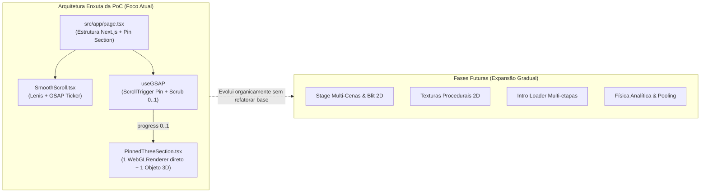

# Plano de Implementação: Next.js + TypeScript (Prova de Conceito e Fases)

> **Classificação de Informações:**
> - **[FATO OBSERVADO]**: Lições aprendidas da engenharia reversa do código de referência.
> - **[RECOMENDAÇÃO]**: Diretrizes de arquitetura simplificada, padrões TypeScript e plano incremental para a Prova de Conceito (PoC) e fases futuras.

---

## 1. Princípios de Engenharia e Contexto Estratégico

Este projeto materializa um estudo de caso para uma **sorveteria artesanal fictícia de alta gastronomia**, servindo como **vitrine comercial da MW Technology** e laboratório avançado de aprendizado técnico. Para mais detalhes estratégicos, consulte [**`docs/strategic-context.md`**](file:///home/mwtechnology/Documentos/MWT/site_sorveteria/docs/strategic-context.md).

### Diretrizes Centrais:
1. **Três Objetivos**:
   - *Aprendizado técnico*: domínio rigoroso de Next.js, GSAP, ScrollTrigger, Lenis e Three.js.
   - *Portfólio*: produzir uma experiência digital original, sofisticada e tecnicamente impecável.
   - *Comercial*: demonstrar a proprietários de sorveterias o impacto comercial de uma presença digital de alto padrão.
2. **Separação Modular**:
   - *Componentes Técnicos Reutilizáveis (Core MW Technology)*: `SmoothScroll`, `useLenis`, `useGSAP`, `AdaptiveCanvas`, descarte de memória GPU.
   - *Componentes de Domínio (Sorveteria)*: malhas de gelato, vitrine de sabores, narrativa de ingredientes e jornada da marca.
3. **Ética e Honestidade**: Sem invenção de resultados comerciais fictícios, métricas de conversão forjadas ou falsos depoimentos.
4. **Sem Abstrações Prematuras**: Não implementar gerenciador de 15 cenas, nem sistema complexo de blit 2D, nem gerador procedural de 50KB de texturas na Prova de Conceito.
5. **Zero Cópia de Identidade Visual e Código**: Identidade visual, marca, paleta, tipografia e modelos 3D são 100% originais.
6. **Escrita Direta vs. Re-render**: O scroll atualiza o Three.js de forma imperativa direta no frame, sem disparar reconciliações React (`useState`).
7. **Cleanup Absoluto**: 100% dos recursos alocados (listeners, timelines, geometrias, materiais, contextos WebGL) são destruídos no unmount.



---

## 2. Diferenciações Técnicas e Escolha de Renderização

### 2.1. Canvas Fora do DOM vs. OffscreenCanvas vs. Web Workers
- **Canvas Desacoplado do DOM (Usado na Referência)**: `document.createElement('canvas')` mantido fora do DOM na Main Thread. Permite sincronização perfeita e síncrona com Lenis/ScrollTrigger.
- **OffscreenCanvas API (W3C)**: Interface sem conexão com a árvore visual.
- **WebGL em Web Workers**: Executar Three.js em thread separada introduz latência de mensageria assíncrona (`postMessage`), gerando jitter e dessincronização espacial entre o scroll do DOM e o objeto 3D.
- **Decisão para a PoC**: Renderização WebGL direta na Main Thread acoplada ao GSAP Ticker, garantindo latência zero de sincronização.

### 2.2. WebGL + 2D Blit vs. Shared WebGLRenderer com Múltiplas Views
- **Blit 2D (`drawImage`)**: Copia pixels da GPU para canvases 2D no DOM. Excelente para múltiplas cenas e split-layering (3D atrás e à frente de textos), mas custa banda de memória.
- **Shared Viewport/Scissor**: 1 canvas WebGL de tela inteira com janelas de renderização recortadas via `setViewport` e `setScissor`. Mais eficiente em GPU, mas complexo para sincronização de pins.
- **Decisão para a PoC**: **Renderizador WebGL direto contido na seção pinada**. Como a PoC possui apenas uma seção pinada com 3D, montar o canvas WebGL diretamente na seção elimina completamente a complexidade de blit 2D e de scissors prematuros, entregando a máxima taxa de quadros e simplicidade de código.

---

## 3. Disponibilidade e Licenciamento dos Plugins GSAP

| Pacote / Módulo | Licença | Status | Estratégia Adotada |
| :--- | :--- | :--- | :--- |
| **gsap** (Core) | GreenSock Standard | Gratuito para uso comercial padrão | Oficial |
| **gsap/ScrollTrigger** | GreenSock Standard | Gratuito para uso comercial padrão | Oficial |
| **@gsap/react** | MIT | Gratuito e open-source oficial | Oficial (`useGSAP`) |
| **SplitText** | Club GreenSock | **Pago** (requer assinatura comercial) | Substituir por `split-type` (MIT) |
| **CustomEase** | Club GreenSock | **Pago** (requer assinatura comercial) | Substituir por `bezier-easing` (MIT) |

---

## 4. Dependências Estáveis e Compatíveis

```json
{
  "dependencies": {
    "next": "^14.2.18",
    "react": "^18.3.1",
    "react-dom": "^18.3.1",
    "three": "^0.170.0",
    "gsap": "^3.12.5",
    "@gsap/react": "^2.1.1",
    "lenis": "^1.1.14"
  },
  "devDependencies": {
    "@types/node": "^20.14.0",
    "@types/react": "^18.3.12",
    "@types/react-dom": "^18.3.1",
    "@types/three": "^0.170.0",
    "typescript": "^5.6.3"
  }
}
```
*Justificativa*: Versões modernas e estáveis do ecossistema. Next.js 14.2.18 e React 18.3.1 oferecem suporte consolidado sem os conflitos de tipagem ou quebra de hooks de bibliotecas terceiras que ainda afetam o React 19 recém-lançado. O pacote de smooth scroll utilizado é `lenis` (versão moderna e unificada da biblioteca).

---

## 5. Estrutura Enxuta para a Prova de Conceito (PoC)

```
site_sorveteria/
├── docs/                               # Documentação técnica e arquitetural
│   ├── architecture-analysis.md
│   ├── animation-system.md
│   ├── rendering-system.md
│   └── implementation-plan.md
├── src/
│   ├── app/
│   │   ├── layout.tsx                  # HTML semântico, meta viewport, fontes
│   │   ├── page.tsx                    # Página da PoC com Hero, Pin Section e Footer
│   │   └── globals.css                 # Reset mínimo, tokens e classes de fallback
│   ├── components/poc/
│   │   ├── SmoothScroll.tsx            # Inicialização e bind Lenis + GSAP Ticker
│   │   └── PinnedThreeSection.tsx      # Seção pinada com Canvas Three.js e Scrub
│   └── hooks/
│       └── useReducedMotion.ts         # Hook reativo para prefers-reduced-motion
```

---

## 6. Padrões de Código da PoC (TypeScript)

### 6.1. Inicialização do Lenis no GSAP Ticker (`SmoothScroll.tsx`)
```tsx
'use client';

import { useEffect } from 'react';
import Lenis from 'lenis';
import gsap from 'gsap';
import { ScrollTrigger } from 'gsap/ScrollTrigger';

if (typeof window !== 'undefined') {
  gsap.registerPlugin(ScrollTrigger);
}

export function SmoothScroll({ children }: { children: React.ReactNode }) {
  useEffect(() => {
    // Se o usuário prefere movimento reduzido, não ativa smooth scroll artificial
    const prefersReduced = window.matchMedia('(prefers-reduced-motion: reduce)').matches;
    if (prefersReduced) return;

    const lenis = new Lenis({
      lerp: 0.1,
      wheelMultiplier: 1.0,
      touchMultiplier: 1.2,
    });

    lenis.on('scroll', ScrollTrigger.update);

    const tickerCb = (time: number) => {
      lenis.raf(time * 1000);
    };

    gsap.ticker.add(tickerCb);
    gsap.ticker.lagSmoothing(0);

    return () => {
      gsap.ticker.remove(tickerCb);
      lenis.destroy();
    };
  }, []);

  return <>{children}</>;
}
```

### 6.2. Seção Pinada com Objeto Three.js Controlado pelo Scroll (`PinnedThreeSection.tsx`)
```tsx
'use client';

import { useRef, useEffect } from 'react';
import * as THREE from 'three';
import gsap from 'gsap';
import { ScrollTrigger } from 'gsap/ScrollTrigger';
import { useGSAP } from '@gsap/react';

export function PinnedThreeSection() {
  const sectionRef = useRef<HTMLDivElement>(null);
  const canvasContainerRef = useRef<HTMLDivElement>(null);
  const progressRef = useRef(0);
  const sceneStateRef = useRef<{
    renderer?: THREE.WebGLRenderer;
    mesh?: THREE.Mesh;
    reqId?: number;
    cleanup?: () => void;
  }>({});

  // 1. Configuração do Three.js isolada com limpeza estrita
  useEffect(() => {
    const container = canvasContainerRef.current;
    if (!container) return;

    const testCanvas = document.createElement('canvas');
    const hasWebGL = !!(window.WebGL2RenderingContext && testCanvas.getContext('webgl2'));
    if (!hasWebGL) {
      container.classList.add('has-no-webgl');
      return;
    }

    const width = container.clientWidth || 600;
    const height = container.clientHeight || 600;

    const renderer = new THREE.WebGLRenderer({ antialias: true, alpha: true });
    renderer.setSize(width, height);
    renderer.setPixelRatio(Math.min(window.devicePixelRatio || 1, 1.5));
    container.appendChild(renderer.domElement);

    const scene = new THREE.Scene();
    const camera = new THREE.PerspectiveCamera(35, width / height, 0.1, 50);
    camera.position.set(0, 0, 6);

    const ambientLight = new THREE.AmbientLight(0xfff5eb, 1.2);
    const dirLight = new THREE.DirectionalLight(0xffffff, 2.0);
    dirLight.position.set(3, 4, 5);
    scene.add(ambientLight, dirLight);

    // Geometria autoral da PoC: forma helicoidal orgânica de gelato
    const geometry = new THREE.TorusKnotGeometry(1.1, 0.38, 96, 24);
    const material = new THREE.MeshStandardMaterial({
      color: 0xdeb887,
      roughness: 0.35,
      metalness: 0.05,
    });
    const mesh = new THREE.Mesh(geometry, material);
    scene.add(mesh);

    let isRunning = true;
    const renderLoop = () => {
      if (!isRunning) return;
      const p = progressRef.current;

      // O objeto 3D reage bidirecionalmente ao progresso de scroll
      mesh.rotation.y = p * Math.PI * 2;
      mesh.rotation.x = Math.sin(p * Math.PI) * 0.4;
      mesh.position.y = (p - 0.5) * 0.8;
      mesh.scale.setScalar(0.9 + Math.sin(p * Math.PI) * 0.2);

      renderer.render(scene, camera);
      requestAnimationFrame(renderLoop);
    };
    renderLoop();

    const handleResize = () => {
      if (!container) return;
      const w = container.clientWidth;
      const h = container.clientHeight;
      camera.aspect = w / h;
      camera.updateProjectionMatrix();
      renderer.setSize(w, h);
    };
    window.addEventListener('resize', handleResize);

    sceneStateRef.current = {
      renderer,
      mesh,
      cleanup: () => {
        isRunning = false;
        window.removeEventListener('resize', handleResize);
        geometry.dispose();
        material.dispose();
        renderer.dispose();
        renderer.forceContextLoss();
        if (renderer.domElement.parentElement) {
          renderer.domElement.parentElement.removeChild(renderer.domElement);
        }
      },
    };

    return () => {
      sceneStateRef.current.cleanup?.();
    };
  }, []);

  // 2. GSAP ScrollTrigger com Pinning e Scrub Reversível via useGSAP
  useGSAP(
    () => {
      const prefersReduced = window.matchMedia('(prefers-reduced-motion: reduce)').matches;
      if (prefersReduced) {
        progressRef.current = 0.5; // Posição estática de repouso
        return;
      }

      ScrollTrigger.create({
        trigger: sectionRef.current,
        start: 'top top',
        end: '+=150%',
        pin: true,
        scrub: 0.5,
        anticipatePin: 1,
        onUpdate: (self) => {
          progressRef.current = self.progress;
        },
      });
    },
    { scope: sectionRef }
  );

  return (
    <section ref={sectionRef} className="pin-section">
      <div className="pin-content">
        <h2>Gelato Artesanal: Escultura em Movimento</h2>
        <p>Gire e explore a consistência aveludada através do scroll.</p>
      </div>
      <div ref={canvasContainerRef} className="pin-canvas-container">
        {/* Fallback estático caso WebGL não seja suportado */}
        <div className="gl-fallback-static" aria-hidden="true">
          <div className="placeholder-art" />
        </div>
      </div>
    </section>
  );
}
```

---

## 7. Critérios Verificáveis de Aceite da Prova de Conceito

| Categoria | Critério Objetivo / Verificável | Como Será Validado |
| :--- | :--- | :--- |
| **Desempenho** | • Framerate $\ge 55$ FPS contínuos durante o scrub.<br>• Draw calls $\le 5$ por frame.<br>• Zero alocações de objetos ou arrays no render loop. | Painel de Performance do Chrome DevTools / `renderer.info`. |
| **Scroll Reversível** | • O objeto 3D avança de 0 a 1 e recua de 1 a 0 com fidelidade milimétrica em qualquer velocidade de rolagem sem dessincronização. | Teste de scroll com wheel rápido para cima e para baixo. |
| **Acessibilidade** | • Ao ativar `prefers-reduced-motion: reduce` no sistema operacional/navegador, o smooth scroll é desligado e o objeto 3D repousa estático na posição final sem girar.<br>• Contraste mínimo de texto $\ge 4.5:1$. | Emulação de `prefers-reduced-motion: reduce` no Chrome DevTools Rendering. |
| **Responsividade** | • Layout responsivo adaptado entre 320px (mobile) e 2560px (ultra-wide).<br>• `ScrollTrigger.config({ ignoreMobileResize: true })` impede saltos de pin na abertura da barra de endereços mobile. | Redimensionamento contínuo da janela e emulação de dispositivos iOS/Android. |
| **Descarte de Recursos** | • Ao desmontar o componente ou navegar para outra rota, 100% dos recursos são liberados:<br>  - `ScrollTrigger.getAll().length === 0`<br>  - Listeners de `resize` e ticker desanexados<br>  - `renderer.dispose()` e `forceContextLoss()` executados<br>• Zero vazamento de memória GPU após 20 ciclos de montagem/desmontagem. | Monitoramento de memória no DevTools (`Memory Heap Snapshot`) e contagem de WebGL Contexts. |
| **Fallback WebGL** | • Se o WebGL for desativado ou não suportado, a seção exibe imediatamente o visual estático sem travar a página nem disparar erros no console. | Emulação de WebGL desativado (`chrome://flags/#disable-webgl`). |

---

## 8. Decisões Técnicas Submetidas para Aprovação

1. **Escopo Focado da PoC**:
   - Aprovação para implementar estritamente a página com Lenis + GSAP ScrollTrigger + 1 Seção Pinada + 1 Objeto Three.js scrubbable + Fallback e Cleanup completo, deixando texturas procedurais complexas e múltiplas cenas para a Fase 2.
2. **Dependências Estáveis**:
   - Uso de `next@14.2.18`, `react@18.3.1`, `three@0.170.0`, `gsap@3.12.5`, `@gsap/react@2.1.1` e `lenis@1.1.14`.
3. **Licenciamento GSAP**:
   - Adoção de plugins open-source gratuitos (`split-type` e `bezier-easing`) caso divisão de texto ou curvas bezier sejam necessárias, sem necessidade de licença comercial paga do Club GreenSock.
