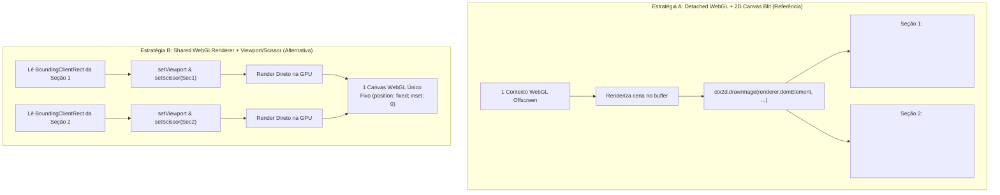
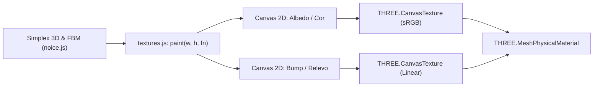

# Sistema de Renderização WebGL e 3D: Engenharia Reversa e Alternativas

> **Classificação de Informações:**
> - **[FATO OBSERVADO]**: Baseado diretamente na análise estática de `stage_js.txt`, `scenes_js.txt`, `textures_js.txt`, `food_js.txt`, `noice_js.txt` e `dishes_js.txt`.
> - **[INFERÊNCIA]**: Dedução técnica fundamentada em computação gráfica e arquitetura de navegadores.
> - **[RECOMENDAÇÃO]**: Diretrizes de renderização e materiais procedurais para o novo projeto (Sorveteria Artesanal).

---

## 1. Diferenciação Crucial de Conceitos de Renderização Gráfica

Um equívoco comum em projetos web interativos é misturar três conceitos arquiteturais distintos de renderização:

```mermaid
flowchart TD
    subgraph Conceito_1["1. Canvas Fora do DOM (DOM-Detached Canvas)"]
        Detached["document.createElement('canvas')<br>(NUNCA inserido no body)"]
        DetachedMain["Executa 100% na MAIN THREAD"]
        DetachedGL["Gera WebGLRenderingContext padrão"]
        DetachedBlit["Serve de fonte para ctx.drawImage()"]
        Detached --> DetachedMain --> DetachedGL --> DetachedBlit
    end

    subgraph Conceito_2["2. OffscreenCanvas API Nativa (HTML5)"]
        NativeOffscreen["new OffscreenCanvas(w, h)<br>ou canvas.transferControlToOffscreen()"]
        NativeThread["Pode rodar na Main Thread OU em Worker"]
        NativeSpec["Não é um Elemento DOM (sem style, sem addEventListener)"]
        NativeOffscreen --> NativeThread --> NativeSpec
    end

    subgraph Conceito_3["3. WebGL em Web Workers"]
        WorkerInit["new Worker('gl-worker.js')"]
        WorkerTransfer["postMessage({ canvas }, [offscreenCanvas])"]
        WorkerThread["Loop de renderização Three.js isolado em Thread dedicada"]
        WorkerInit --> WorkerTransfer --> WorkerThread
    end
```



### 1. Canvas Fora do DOM (*DOM-Detached HTMLCanvasElement*) [FATO OBSERVADO]
- **O que a referência faz**: No arquivo `stage_js.txt`, o renderizador é criado via:
  ```javascript
  const renderer = new THREE.WebGLRenderer({ antialias: true, alpha: true, ... });
  ```
  O Three.js cria internamente um `<canvas>` padrão via `document.createElement('canvas')`. O código **nunca insere `renderer.domElement` no DOM**.
- **Onde roda**: Executa **integralmente na Main Thread**.
- **Vantagens**: Acesso direto e síncrono a todas as variáveis de estado, eventos de scroll e ponteiro, sem latência de comunicação assíncrona.
- **Desvantagens**: Compartilha a mesma thread do cálculo de layout, CSS e JavaScript da aplicação.

### 2. OffscreenCanvas API Nativa (Especificação W3C) [INFERÊNCIA TÉCNICA]
- **O que é**: Uma interface de baixo nível criada especificamente para desvincular o ciclo de vida do canvas do documento visual. Pode ser instanciado diretamente via `new OffscreenCanvas(width, height)` ou obtido desanexando um canvas DOM via `canvas.transferControlToOffscreen()`.
- **Diferenças**: Não é um nó da árvore do DOM. Não possui propriedades de estilo CSS (`style.width`), não recebe eventos de mouse (`pointermove`) diretamente e não dispara eventos de mutação DOM.

### 3. WebGL em Web Workers [INFERÊNCIA TÉCNICA & TRADE-OFFS]
- **O que é**: Mover o loop do Three.js e o contexto WebGL para um arquivo de Web Worker (`gl.worker.ts`) usando `OffscreenCanvas`.
- **Trade-offs Práticos no Ecossistema Web**:
  - *Vantagem teórica*: Zero impacto do JavaScript pesado ou de reflows do DOM na taxa de quadros (framerate) do 3D.
  - *Problema crítico na prática*: Como os eventos de rolagem (`scroll`, `Lenis`, `ScrollTrigger`) residem obrigatoriamente na Main Thread, cada frame exige comunicação assíncrona bidirecional via `postMessage`. Em seções com pins ou scrub milimétrico, essa troca de mensagens introduz **jitter e defasagem visual** (*frame latency*) entre o elemento HTML pinado e o objeto 3D. Além disso, o suporte ao `OffscreenCanvas` em Web Workers no iOS Safari historicamente apresenta bugs de vazamento de contexto.
- **Conclusão**: O uso de **DOM-Detached Canvas na Main Thread sincronizado ao Ticker do GSAP** é a escolha mais estável e precisa para experiências scroll-driven.

---

## 2. Comparativo: WebGL + 2D Blit vs. WebGLRenderer Compartilhado com Múltiplas Views



### Análise Comparativa Detalhada

| Aspecto | Estratégia A: WebGL Detached + 2D Blit (`stage.js`) | Estratégia B: Shared WebGL + Multiple Viewports / Scissor |
| :--- | :--- | :--- |
| **Contextos WebGL** | **1 único** (evita o limite do navegador de 8 a 16) | **1 único** (evita o limite do navegador de 8 a 16) |
| **Custo de GPU / Framebuffer** | **Alto**: Dupla passagem de memória. A GPU renderiza no buffer WebGL e a Main Thread executa `ctx.drawImage()`, copiando pixels da VRAM para o canvas 2D. | **Mínimo**: Renderização direta da GPU para o framebuffer de apresentação sem cópia intermediária. |
| **Integração com o Fluxo DOM** | **Perfeita e Natural**: Os `<canvas>` 2D são filhos normais das seções HTML. Rolam, fixam via `position: sticky` ou pin do ScrollTrigger sem cálculo manual de coordenadas. | **Complexa**: O canvas WebGL fica fixo na tela. É obrigatório ler as coordenadas globais de cada seção a cada frame e sincronizar viewports. |
| **Camadas Split (Sanduíche de Texto)** | **Nativa e Trivial**: Permite colocar um canvas 2D atrás do texto e outro canvas 2D (`.gl-front`) à frente do texto, intercalando 3D e HTML. | **Muito Difícil**: O 3D fica todo atrás do DOM ou todo na frente. Exigiria múltiplos passes de compositing ou fragment shaders de oclusão. |
| **Consumo de Bateria / Mobile** | Maior consumo de memória e largura de banda em resoluções altas (Retina/4K). | Menor consumo de energia e menor aquecimento em mobile. |
| **Complexidade de Código** | Baixa a moderada no loop de renderização. | Alta para sincronização de layout e redimensionamento responsivo. |

### Decisão Técnica e Recomendação para o Projeto [RECOMENDAÇÃO]
1. **Para a Prova de Conceito (PoC)**:
   - Como a PoC possui **apenas 1 seção pinada e 1 objeto 3D**, a técnica mais limpa, performática e direta é utilizar **um canvas WebGL direto na própria seção pinada**. Não há necessidade de blit 2D nem de gerenciador multi-views para uma única cena. Isso elimina abstração prematura e maximiza a taxa de quadros.
2. **Para a Experiência Completa (Fase 2)**:
   - Se o design final exigir que elementos 3D fiquem atrás e na frente da tipografia simultaneamente (efeito *split-layer*), adota-se a Estratégia A (Blit 2D) com **Pixel Budget** estrito e **Quality Governor**. Caso contrário, adota-se a Estratégia B (Shared Viewport), mais rápida e eficiente.

---

## 3. Dissecção das Cenas e Otimizações de Física (`scenes.js`)

### 3.1. Cena 01: Hero (Colisão Analítica Multi-Pass e Levitação) [FATO OBSERVADO]
- **Colisões Analíticas**: Em vez de carregar um motor de física pesado (como Cannon ou Rapier, que adicionariam 150KB+ de bundle), a cena usa colisão geométrica analítica em duas passagens:
  - Esfera contra esfera para ingredientes orbitais ($d < r_1 + r_2$).
  - Esfera contra cilindros aproximados do corpo do pincho.
  - Repulsão do cursor via projeção no plano $Z=0$ através de `Raycaster`.
- **Amortecimento**: Velocidades lineares e angulares decaem exponencialmente via `Math.exp(-dt * damping)`, garantindo estabilização natural.

### 3.2. Cena 02: Build (Morphing com Morph Targets e Scrub Bidirecional) [FATO OBSERVADO]
- **Deformação de Malhas**: A fusão do queijo na chapa não é uma animação pré-renderizada, mas uma transição geométrica via `morphTargetInfluences[0]`.
- **Mapeamento de Scrub Reversível**:
  $$\text{range}(P, a, b) = \text{clamp}\left(\frac{P - a}{b - a}\right)$$
  Permite que o usuário role para frente e para trás em qualquer velocidade, mantendo cada etapa sincronizada com o scroll.

### 3.3. Cena 03: Drinks (Impacto Físico e Recoil Elástico) [FATO OBSERVADO]
- **Cálculo de Impacto**: No instante de toque dos copos ($P \ge 0.995$), o tempo é registrado (`clinkAt = t`). Um choque com recoil oscilatório amortecido é calculado via $\sin(\Delta t \cdot 9) \cdot e^{-\Delta t \cdot 4}$, disparando faíscas procedurais.

### 3.4. Cena 04: Rain (Chuva de Modelos com Pooling Estrito) [FATO OBSERVADO]
- **Zero Alocação no Scroll**: Malhas 3D clonadas durante a rolagem geravam quedas de framerate de até 190 ms. A arquitetura pré-aloca um pool de $N$ objetos durante o carregamento inicial (`pool`). Durante a chuva, o motor apenas reposiciona e ativa os objetos já existentes.

---

## 4. Geração Procedural de Texturas e Materiais (`textures.js`)

Uma das maiores virtudes da arquitetura é a **ausência quase total de texturas transferidas por download via rede**:



- **Economia de Rede Extrema**: 0 KB de tráfego de imagens pesadas para materiais complexos.
- **Independência de Resolução**: Texturas geradas programaticamente na resolução ideal do dispositivo.
- **Adaptação para Gelateria**: Criar texturas procedurais de massa de gelato cremoso, calda brilhante, casquinha waffle e coberturas crocantes.

---

## 5. Orçamento de Performance e Governança de Qualidade

### 5.1. Orçamento de Pixels (Pixel Budget) [FATO OBSERVADO]
```javascript
const budget = mobile ? 1.6e6 : 3.0e6;
const screenPx = window.innerWidth * window.innerHeight;
const maxDpr = Math.max(0.75, Math.min(window.devicePixelRatio || 1, 1.5, Math.sqrt(budget / screenPx)));
```
Evita que telas 4K ou Retina 3x renderizem 15 a 20 milhões de pixels por frame, limitando o DPR a no máximo 1.5.

### 5.2. O Governador de Qualidade (Quality Governor) [FATO OBSERVADO]
- Monitora o tempo médio de frame em janelas de 1.5 segundos.
- Se o tempo exceder **28 ms** (~35 fps) em **duas janelas consecutivas**, o DPR é reduzido em 0.2 (com piso em 0.7).
- Atua **somente para baixo** (histerese unidirecional) com cooldown de 3 janelas, prevenindo o efeito nocivo de ping-pong de resolução.

### 5.3. Pré-aquecimento de Shaders (Warmup) [FATO OBSERVADO]
- Durante a tela de introdução, executa `renderer.compileAsync(v.scene, v.camera)` seguido de um frame renderizado a frio (`v.warm(true)`). Isso envia geometrias e shaders compilados para a VRAM da GPU antes do primeiro scroll do usuário, eliminando o engasgo (*jank*) de primeiro impacto.

---

## 6. Fallback para Dispositivos sem WebGL

1. **Detecção Antecipada**:
   ```javascript
   function webgl() {
     try {
       const c = document.createElement('canvas');
       return !!(window.WebGL2RenderingContext && c.getContext('webgl2'));
     } catch (e) {
       return false;
     }
   }
   ```
2. **Degradação Elegante**:
   - Cada contêiner 3D inclui uma imagem HTML com a classe `.gl-fallback`.
   - Se o WebGL for suportado, a classe `.has-gl` oculta o fallback e exibe o canvas.
   - Se o WebGL falhar ou for rejeitado, o CSS mantém as ilustrações estáticas perfeitamente visíveis e posicionadas, garantindo que o usuário nunca encontre um espaço vazio.
