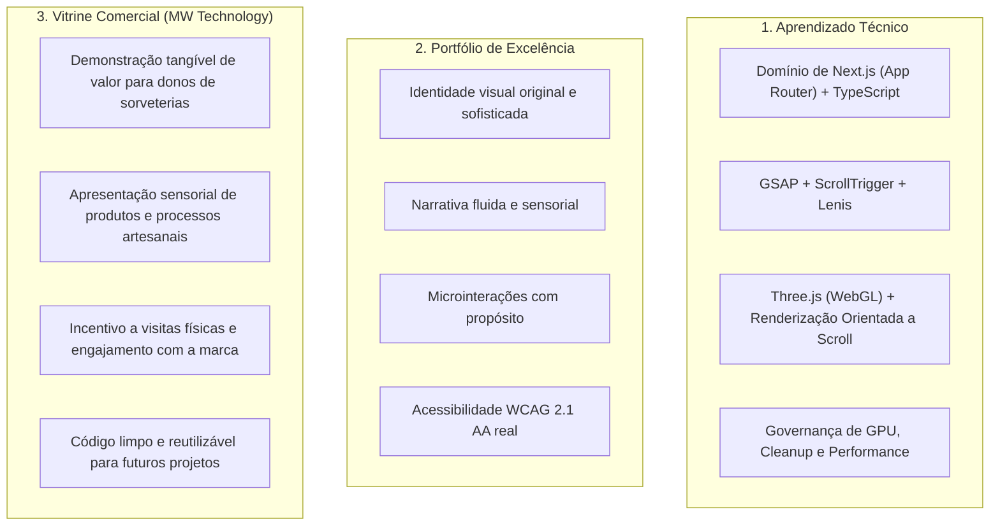

# Contexto Estratégico: Estudo de Caso e Vitrine MW Technology

> **Documento Estratégico de Produto e Engenharia**  
> **Finalidade**: Alinhar objetivos de aprendizado, portfólio de alta fidelidade e posicionamento comercial para proprietários de sorveterias e negócios gastronômicos premium.

---

## 1. Visão Geral e Objetivos do Projeto

Este projeto desenvolve uma experiência web premium para uma **sorveteria artesanal fictícia de alta gastronomia**, atuando simultaneamente como um **estudo de caso técnico** e **vitrine comercial da MW Technology**.

### Os Três Pilares:

---

## 2. Diretrizes Estratégicas e Criativas

1. **Originalidade Absoluta**:
   - O site Tòpas é **exclusivamente uma referência de arquitetura e padrões técnicos**.
   - Identidade visual, paleta de cores, tipografia, redação de conteúdo, ilustrações e malhas 3D serão 100% autorais e desenhados especificamente para o universo de gelatos artesanais.
2. **Propósito e Elegância nas Animações**:
   - Toda animação deve servir à narrativa de marca (ex.: enfatizar a cremosidade do gelato, a textura crocante da casquinha, a frescura dos ingredientes e o processo artesanal).
   - Banimento de efeitos gratuitos que apenas aumentem o peso da página sem agregar valor sensorial ou comercial.
3. **Ética e Transparência Comercial**:
   - **Não inventar resultados comerciais, depoimentos fictícios ou métricas de conversão forjadas**.
   - O projeto deve se sustentar como uma demonstração transparente de excelência em engenharia, design e experiência de usuário.
4. **Arquitetura Modular em Duas Camadas**:
   - **Camada Técnica Reutilizável (Core MW Technology)**: Módulos de smooth scroll, integração GSAP Ticker, wrappers de canvas WebGL, adaptadores de DPI, detecção de acessibilidade e governança de descarte.
   - **Camada de Domínio (Sorveteria Artesanal)**: Modelos 3D de gelatos/taças, vitrine de sabores, narrativa de ingredientes, horários de atendimento e mapa de localização.

---

## 3. Conceito da Marca Fictícia

### Nome Proposto: **"Gelato & Co. — Alta Gelateria Artigianale"** *(ou similar a definir)*
- **Posicionamento**: Gelateria contemporânea de matriz italiana, focada em ingredientes puros, sazonais e técnicas tradicionais de maturação lenta.
- **Narrativa de Marca**:
  - *O Ingrediente*: Pistache de Bronte, favas de baunilha de Madagascar, cacau de origem, leite orgânico de fazenda local.
  - *O Tempo*: Maturação lenta da calda, aeração controlada (baixa incorporação de ar, típica do gelato autêntico).
  - *A Textura*: Cremosa, densa, servida na temperatura perfeita com espátula tradicional.
- **Paleta de Cores Preliminar**:
  - Fundo principal: Creme suave / Fior di latte (`#F8F5EE`).
  - Tons estruturais: Cacau profundo (`#241B18`) e Terracota suave (`#C4684D`).
  - Acentos nobres: Pistache sutil (`#8DA378`) e Dourado quente (`#DFB15B`).

---

## 4. Roteiro de Validação e Próximos Passos

1. **Marco Atual — Prova de Conceito Técnica (PoC)**:
   - Validar estritamente o pipeline de integração: Next.js + TypeScript + Lenis + GSAP ScrollTrigger + Seção Pinada + Tridimensional Three.js scrubbable + Cleanup completo.
   - Sem loader pesado, sem texturas procedurais complexas, sem as demais seções completas.
2. **Marco Seguinte — Aprovação e Implementação Completa (Fases 1, 2 e 3)**:
   - Apresentar os resultados da PoC para aprovação antes de expandir para o site completo.
